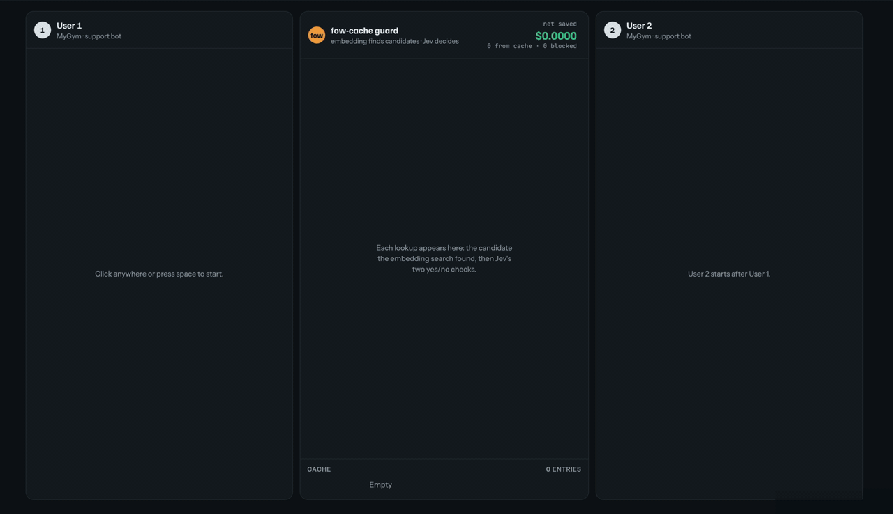

# fow-cache

**How often does your semantic cache serve the wrong answer?**

*fow = fly on the wall: it watches the whole conversation and speaks up when a cached
answer doesn't fit.*

[](https://maby0.github.io/fow-cache/demo/#demo-2-stage)

**[Try the interactive demo](https://maby0.github.io/fow-cache/demo/)**: two support chats
side by side, stepping through each lookup and both of Jev's checks. Scripted replay with
illustrative scores; the flow, thresholds and prices are the library's.

A semantic cache reuses an LLM answer when a new question "means the same" as one it has
seen, usually judged by embedding similarity above a threshold. That works for
rewordings. It fails on questions that differ by one word:

| cached question | new question | embedding similarity |
|---|---|---|
| Track order 48213 | Track order 48231 | 0.994 |
| Is ibuprofen safe with alcohol? | Is ibuprofen unsafe with alcohol? | 0.991 |
| *(a typical genuine paraphrase)* | | 0.815 |

And it fails worse inside conversations, because popular caches compare only the last
message. "Yes, cancel it" in a chat about Netflix and "yes, cancel it" in a chat about a
gym membership are the same string.

fow-cache is a benchmark you can run your own cache against, a CI check that fails
the build when a threshold or model change starts serving wrong answers, a cost model,
and a guard for multi-turn chats.

> **v0.1, early.** The benchmark data and labels were written by language models. A
> human reviewed a 60-pair sample: no label was wrong, but 1 in 6 pairs turned out to
> depend on the application, now tagged `ambiguous` and scored by a setting
> ([`data/REVIEW_LOG.md`](data/REVIEW_LOG.md)). A sweep of the remaining pairs is next,
> so the numbers below may shift a little. Issues and label corrections are welcome. Treat the numbers below as provisional.

## Install

```bash
pip install fow-cache                          # core: no dependencies
pip install "fow-cache[embeddings]"            # + sentence-transformers, for --embedder
pip install "fow-cache[anthropic,redis]"       # the guard with RedisVL
# other extras: gptcache, langchain
```

TypeScript: `npm install fow-cache` (same data, guard and results; see [`js/`](js/)).

## Test your cache

Give `evaluate` the function your cache uses to decide a hit. Return `True`/`False`,
or a score compared against `threshold`.

```python
from fow_cache import evaluate

report = evaluate(lambda cached_q, new_q: my_cache.would_hit(cached_q, new_q))
print(report)
```

```
fow-cache: questions, 600 pairs, threshold 0.5

  should-hit served          81.0%
    near_repeat              96.0%
    paraphrase               74.0%
  traps given wrong answer   81.0%
    negation                 85.0%
    ...
```

Conversations work the same way, with lists of `{role, content}` messages:

```python
report = evaluate(lambda cached_msgs, new_msgs: my_cache.would_hit(cached_msgs, new_msgs),
                  dataset="conversations")
```

Some pairs only share an answer depending on your app: two sides of the same question
("which deductions are lawful?" vs "which are illegal?"), or questions that match only if
your business works a certain way ("my child's school report" vs "their end-of-year
report"). That's a setting: `evaluate(..., ambiguous="different")` (default, strict)
counts them as traps, `"same"` as hits, `"skip"` leaves them out.

`report.best_threshold(max_wrong=0.01)` finds the threshold with the most hits under a
wrong-answer budget (picked on this data, so confirm on your own traffic).

### Test your actual cache

Rather than approximating your setup, run the benchmark through it. Each pair runs
against an empty cache: store one side, look up the other.

```python
from redisvl.extensions.cache.llm import SemanticCache
from fow_cache import evaluate
from fow_cache.adapters import redisvl_check, redisvl_threshold

cache = SemanticCache(name="fow-eval", distance_threshold=0.1, overwrite=True)   # a dedicated cache: it's cleared per pair
report = evaluate(redisvl_check(cache), threshold=redisvl_threshold(cache))
```

`gptcache_check(make_cache)` and `langchain_check(cache)` do the same for GPTCache and
LangChain caches (hit or miss at the cache's own threshold, since neither exposes its
score). For any other cache, `store_lookup_check(store, lookup, reset)` wraps three
functions.

### In CI

```bash
fow-cache eval --embedder sentence-transformers/all-mpnet-base-v2 --threshold 0.90 --max-wrong 0.05
fow-cache eval --check myapp.cache:would_hit --dataset conversations --max-wrong 0.05
```

Exits 1 when more than `--max-wrong` of the traps get a wrong answer.

## What we found

**Single questions** (600 pairs), each scorer at its library's shipped default:

| scorer | should-hit served | traps given a wrong answer |
|---|---|---|
| GPTCache 0.1.44 defaults | 81% | **81%** (93% of one-word edits) |
| RedisVL defaults (langcache-embed-v1) | 51% | 11% |
| all-mpnet-base-v2 at 0.90 | 49% | 27% |
| Jev yes/no check | 98% | 1% |

**Conversations** (240 pairs, 3 to 70 messages, final user messages identical in every trap):

| strategy | should-hit served | traps given a wrong answer |
|---|---|---|
| Last message only (GPTCache's default pre-processing), any embedder | 88% | **98%** |
| Whole conversation, Jev | 100% | 15% (30% on 40-70 message chats) |
| **Guard: whole conversation AND rewrite from batched facts** (held-out, two runs*) | **90-92%** | **3-6%** |

\*Haiku via the Claude Code CLI: 92% / 3%; via the Anthropic API at temperature 0: 90% / 6%
(87% / 10% on 40-70 message chats). Thresholds were tuned for at most 1% wrong answers
on half the pairs and scored on the other half; with 120 traps the gap between runs is
3-4 traps, so treat it as noise and the guard as "about 90% of hits, about 5% wrong".
The guard adds about 1.2 s (median; 1.5 s p90) to a cache lookup, measured through the
Anthropic API and Jev via OpenRouter.

The full tables, failure analysis and caveats are in [`results/`](results/) and
[`wiki/findings.md`](wiki/findings.md).

## The guard (multi-turn chats)

Keep your semantic cache; let it find candidates and let the guard decide. With RedisVL:

```python
from redisvl.extensions.cache.llm import SemanticCache
from fow_cache import Guard, GuardedCache, anthropic_llm, merge_fold
from fow_cache.cache import RedisVLBackend
from fow_cache.jev import JevClient

guard = Guard(llm=anthropic_llm(), decider=JevClient())    # pip install "fow-cache[anthropic,redis]"
cache = GuardedCache(RedisVLBackend(SemanticCache(name="chat", distance_threshold=0.3)), guard)

def handle(conversation_id, user_message):
    chat = guard.conversation(load_state(conversation_id))   # your storage: a dict, Redis, a DB row
    entry = chat.ask(user_message)
    hit = cache.lookup(entry)
    reply = hit.answer if hit else call_your_model(chat.messages, user_message)
    if not hit:
        cache.store(entry, reply)
    chat.record(user_message, reply)         # no model call
    save_state(conversation_id, chat.to_dict())
    if chat.fold_due:                        # every 4th exchange: update the facts later
        run_in_background(fold_facts, conversation_id)   # your task queue, thread or worker
    return reply

def fold_facts(conversation_id):
    update = guard.conversation(load_state(conversation_id)).fold()   # one Haiku call
    save_state(conversation_id, merge_fold(load_state(conversation_id), update))
```

- **How it decides.** Every 4 exchanges, Haiku 4.5 folds the chat into a short record of
  facts. When the cache finds a candidate, both sides' final messages are rewritten into
  standalone requests ("book it" becomes "book the Tuesday 6:30pm spin class at IronWorks
  Bristol") and two [Jev](https://typesafe.ai) checks run: the whole conversations, and
  the rewrites. The answer is served only if both pass.
- **Facts off the request path.** `record()` never calls a model; `fold()` does the Haiku
  call. `merge_fold` keeps messages recorded while a fold ran, and a slow fold never
  overwrites a newer one. If the next message arrives before the fold finishes, the guard
  still sees every unfolded message. `chat.add()` does both in one call if you'd rather
  not run a background task. On AWS Lambda, send the fold to a queue: work after the
  response isn't guaranteed to run.
- **Fails safe.** `check()` never raises. Errors, or a check that runs past `timeout`
  (default 3 s; median is ~1.2 s), come back as a miss, so your app answers normally.
- **Stateless servers.** `chat.to_dict()` / `guard.conversation(state)` persist the running
  state; the snapshot stored with each cached answer travels in the cache entry.
- **Async.** `await cache.alookup(entry)`, `await cache.astore(...)`, `await chat.afold()`,
  `await guard.acheck(...)`.
- **Looser backend threshold.** The backend only finds candidates, so give it more room
  than you would unguarded (`distance_threshold=0.3` above vs RedisVL's 0.1 default).
- **Backends.** `RedisVLBackend` (a redisvl `SemanticCache`), `GPTCacheBackend` (an
  initialised `gptcache.Cache`), `LangChainBackend` (any LangChain cache, including the
  semantic ones in langchain-community) and `InMemoryBackend`. GPTCache and LangChain store
  only text, so fow-cache packs the answer and its snapshot as JSON: give the guard its own
  cache. Anything with `candidates(text, k) -> [(answer, entry_dict)]` and
  `store(text, answer, entry_dict)` works too.
- **API keys.** The guard reads `TYPESAFE_API_KEY` (or `OPENROUTER_API_KEY`, for Jev via
  OpenRouter) and `ANTHROPIC_API_KEY` for the Haiku calls. Benchmarking your own cache
  with `evaluate` or `fow-cache eval --embedder` needs no keys.
- **Other models.** `llm` accepts any `(system, user) -> text` function.
- **Your own decision model.** `decider` is any function `(state, instructions) ->
  probability of yes`, so Jev can be swapped for another yes/no model:

  ```python
  import json, anthropic
  client = anthropic.Anthropic()

  def claude_decider(state, instructions):
      reply = client.messages.create(model="claude-haiku-4-5", max_tokens=3,
                                     system=instructions + " Answer yes or no.",
                                     messages=[{"role": "user", "content": json.dumps(state)}])
      return 1.0 if reply.content[0].text.strip().lower().startswith("yes") else 0.0

  guard = Guard(llm=anthropic_llm(), decider=claude_decider)
  ```

  The default thresholds were tuned on Jev's probabilities. A decider that answers only
  1.0 or 0.0, like this one, works with them as they are; one with its own probabilities
  needs `whole_threshold` and `rewrite_threshold` measured for it (`bench/conv_heldout.py`
  shows how the defaults were picked). A slower decider may need a longer `timeout`
  (default 3 s): this one took about 1.4 s per check, against Jev's 1.2 s. The benchmark
  numbers above are Jev's.

## Why Jev

The guard's checks run on [Jev](https://typesafe.ai), TypeSafe's decision model: it
answers a typed yes/no question about a piece of state with a calibrated probability,
rather than generating text. That's exactly the shape of "can this cached answer be
served?", and on this benchmark it's what makes a guard on the request path practical:

| | median latency per check | input price |
|---|---|---|
| Jev (via OpenRouter, from London) | ~270-380 ms | $0.042 / M tokens, output free |
| Claude Haiku 4.5 (generating the rewrite) | ~1,000 ms | $1 / M tokens, $5 / M output |

Haiku still writes the facts and the rewrites, where generation is the job; every
yes/no decision goes to Jev.

## Does it pay for itself?

The guard costs model calls; a hit saves one main-model turn. Whether that's a saving
depends on your model, prompt size and hit rate:

```bash
fow-cache costs --model sonnet-5.5 --prompt-tokens 8000 --candidate-rate 0.2
```

```
  batched facts (default)              $0.00040/turn   break-even hit rate 7%
  facts every turn                     $0.00100/turn   break-even hit rate 18%
  no facts, full-transcript rewrite    $0.00013/turn   break-even hit rate 2%
```

Rule of thumb from the model: semantic caching pays on expensive models and FAQ-style
traffic. Deep in long chats, hits are rare and prompt caching already makes those turns
cheap, so check the numbers before turning it on.

## Reproduce the benchmark

```bash
uv sync --extra bench
uv run python bench/embeddings.py && uv run python bench/report.py
uv run python bench/conversations.py --env-file .env      # needs OPENROUTER_API_KEY
uv run python bench/conv_report.py && uv run python bench/conv_heldout.py
```

`bench/conversations.py --haiku-via claude-cli` runs the Haiku calls through a logged-in
Claude Code CLI instead of an API key (not temperature 0, so numbers vary slightly).

## Contributing

Install the pre-commit hook once per clone: `git config core.hooksPath .githooks`. It
blocks staged files over 5,000 tokens (bytes / 4) and says how to split them; lockfiles,
generated code, benchmark data and binaries are skipped (`scripts/check_file_tokens.py`).

## Licence

Code: MIT. Data (`data/`): CC BY 4.0.
